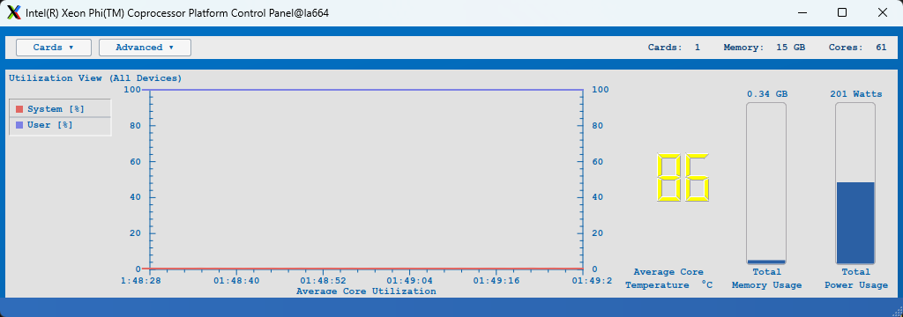

# micsmc-qt — Qt6 桌面控制面板

[English](README.md) | **简体中文**

Intel MPSS 控制面板 `micsmc-gui` 的 Qt6 复刻：原生桌面应用，界面布局与配色
沿用该面板的观感（菜单条 / 总览面板 / 卡视图 / 右侧字段控件 / 设置对话框）。

- **Qt6 Widgets**，无 qt6-charts 依赖——曲线、柱状图、数字温度牌均为 QPainter 自绘
- **工作线程采集**：所有 `mic_*` 调用都在 QThread 内，UI 线程只接收 queued signal
- 双语界面（默认跟随系统区域设置，可在 Advanced 菜单切换）
- 设备切换、Turbo / LED 控制、Advanced Settings 对话框

## 界面预览



总览视图（`Utilization View (All Devices)`），示例为一卡系统
（`Cards: 1  Memory: 15 GB  Cores: 61`）：左侧图例与 60 秒双曲线、右侧温度数码管 /
内存条 / 功耗条。图中核心温度 86 °C 已越过首级门限（默认 85 °C），数码管因此呈
**黄色**告警色——三级告警（黄 / 橙 / 红）的显示与配置见 §5.4 与 §6。

---

## 1. 依赖

### 1.1 构建期

| 依赖 | 版本/说明 | AOSC OS 安装 |
|---|---|---|
| CMake | ≥ 3.16 | `sudo pacman -S cmake` |
| C++ 编译器 | 支持 C++17（gcc / clang） | `sudo pacman -S gcc` |
| Qt6 Base | 需要 `Qt6::Widgets`（qt6-base） | `sudo pacman -S qt6-base` |
| libmicmgmt | 提供 `miclib.h` 与 `libmicmgmt.so`（MPSS 的 `04-mpss-micmgmt`） | 随 MPSS 包安装 |
| libscif | 提供 `libscif.so`（MPSS 的 `02-libscif`） | 随 MPSS 包安装 |

CMake 通过 `find_package(Qt6 ...)` 找 Qt，通过 `-lmicmgmt -lscif` 直接链接 MPSS 库
（不提供 pkg-config，需库文件在默认搜索路径）。`miclib.h` 由 mpss-micmgmt 装到
`/usr/include`。

### 1.2 运行期

- Linux 内核的 `mic` 驱动已加载（`lsmod | grep mic`），MPSS 服务已就绪
  （`micctrl --status` 能看到卡）
- 至少一块 Intel Xeon Phi（KNC）协处理器
- 图形环境（X11 或 Wayland）；远程使用见 §4.3
- **修改卡设置需要 root**（原版同样如此）；只做监控时普通用户即可

---

## 2. 构建（make）

在项目根目录（即本 README 所在目录）下执行：

```bash
mkdir -p build && cd build
cmake ..
make -j$(nproc)
```

产物：`build/micsmc-qt`

常用 cmake 选项：

```bash
cmake -DCMAKE_BUILD_TYPE=Release ..        # 优化构建
cmake -DCMAKE_INSTALL_PREFIX=/usr ..       # 指定安装前缀（默认 /usr/local）
```

---

## 3. 安装 / 卸载

```bash
cd build
sudo make install      # 默认装到 /usr/local
sudo make uninstall    # 依据 install_manifest.txt 精确卸载
```

| 安装项 | 路径（默认前缀 `/usr/local`） |
|---|---|
| 可执行文件 | `<prefix>/bin/micsmc-qt` |
| 桌面入口 | `<prefix>/share/applications/micsmc-qt.desktop` |

自定义前缀二选一：

```bash
cmake -DCMAKE_INSTALL_PREFIX=/usr .. && sudo make install   # 配置期
sudo cmake --install . --prefix /opt/micsmc                 # 安装期临时覆盖
```

打包暂存（DESTDIR）同样支持：

```bash
DESTDIR=/tmp/pkg make install
DESTDIR=/tmp/pkg make uninstall
```

卸载行为说明（详见 `cmake_uninstall.cmake.in`）：

1. **路径以 `install_manifest.txt` 为准**——它是 install 当时写下的真实绝对路径，
   因此用 `--prefix` 覆盖前缀安装后，也不会按配置期前缀删错位置。
2. **白名单安全闸**：只删除 `micsmc-qt` / `micsmc-qt.desktop` 两个条目；
   manifest 若混入其他路径会跳过并告警。
3. **只删文件，不删目录**：避免误删 `/usr/bin`、`/usr/share/applications`
   这类共享目录（`REMOVE_RECURSE` 会连带删掉别人的文件）。卸载后可能留下
   空目录，需要时手工清理。

---

## 4. 运行

### 4.1 直接运行（未安装）

```bash
cd build && ./micsmc-qt
```

### 4.2 安装后运行

```bash
micsmc-qt                      # 命令行启动
# 或在桌面环境的应用程序菜单里找 "Xeon Phi Control Panel"
```

### 4.3 远程使用

程序是原生 GUI，远程需要转发图形界面：

```bash
ssh -X 用户名@主机 micsmc-qt    # X11 转发
# 或用 VNC / RDP 登录桌面后启动
```

> X11 转发下曲线刷新会受网络延迟影响；对刷新率敏感时建议用 VNC / RDP
> 登录桌面后本地运行。

### 4.4 可选环境变量

| 变量 | 作用 |
|---|---|
| `MICSMC_QT_THEME=dark` | 切换到暗色主题（缺省为复刻原版的亮色） |

---

## 5. 使用说明

启动后窗口自上而下分四层：**菜单条 → 总览面板 → （选卡后出现）卡视图 → 状态栏**。
数据每秒刷新一次。

### 5.1 菜单条

| 控件 | 功能 |
|---|---|
| `Cards ▾` | 下拉列出系统里的每块卡（`mic0`、`mic1`…）；`Show All` 展开卡视图；`Hide All` 收起 |
| `Advanced ▾` | `Error Log` / `Advanced Settings…` / `Update Application` / `Info` / `About…`，末项为中英文切换 |
| 右侧 `Cards: N  Memory: xx GB  Cores: N` | 设备数 / 内存总量 / 总核数 |

### 5.2 总览面板（`Utilization View (All Devices)`）

- **图例**：`System [%]`（红）、`User [%]`（紫），对应下方两条曲线
- **曲线图**：最近 **60 秒** 时间序列，左右双 Y 轴（0–100），X 轴为时间戳，
  轴标题 `Average Core Utilization`
- **温度字段**：7 段数码管显示核心温度（°C），下方标注
  `Average Core / Temperature °C`
- **内存字段**：上方为已用值（GB），中间竖直进度条，下方 `Total Memory Usage`
- **功耗字段**：上方为瞬时功率（Watts），中间竖直进度条，下方 `Total Power Usage`

### 5.3 卡视图（从 `Cards ▾` 选某块卡后展开）

选中卡后窗口向下扩展，出现标题为 `mic0: Utilization View` 的面板，结构与总览
面板相同，但数据只针对该卡（温度标签变为 `Processor Core`，内存/功耗为单卡值）。

面板**右上角两个小按钮**切换视图：

| 按钮 | 视图 |
|---|---|
| ▤ | `Utilization View`（默认，时间序列曲线） |
| ▥ | `Core Histogram View`（每核一根柱的柱状图，悬停显示 `Core N: x%`） |

### 5.4 告警显示

- **温度三级 overlay**（直接改变数码管颜色）：
  黄 = 超过 `coreTempLimit`（默认 **85 °C**）、橙 = 超过 `coreTempCaution`（默认 +10）、
  红 = 超过 `coreTempCritical`（默认 +20）
- **功耗条分区着色**：条内超过设备上报门限的部分依次染黄 / 橙 / 红
  （对应 Low / High / Shutdown setpoint；进入 shutdown 上限 10% 内即显示红）
- 状态栏显示动作结果与错误信息

### 5.5 修改卡设置

`Advanced ▾ → Advanced Settings…`：

- **Card Settings**：每块卡一列复选框
  - `Turbo` / `LED` —— 勾选后点 `OK` 立即生效（无需重启卡）
  - `ECC` —— **置灰未实现**（需要维护模式全流程：进入维护模式 → 设置 → 轮询进度 → 退出）
- **Card Connections**：显示各卡在线状态
- **Log File**：占位说明（日志轮转由 mpssd 管理，本程序未接入）

> 修改设置需以 root 运行；非 root 只能查看。

---

## 6. 运行时配置

| 项 | 说明 |
|---|---|
| 配置文件 | `~/.config/mpss3-LoongArch-port/micsmc-qt.conf`（QSettings） |
| 界面语言 | 键 `lang`（`zh`/`en`）；未设置时跟随系统区域设置 |
| 温度门限 | 键 `MicSettingsCpuStat/coreTempLimit`（默认 85）、`coreTempCaution`（默认 +10）、`coreTempCritical`（默认 +20） |
| 主题 | `MICSMC_QT_THEME=dark`（缺省亮色） |

温度告警分三级（黄 / 橙 / 红 overlay，直接改变数码管颜色），门限均可配置：

| 配置键 | 含义 | 默认值 |
|---|---|---|
| `MicSettingsCpuStat/coreTempLimit` | 首级（黄） | 85 °C |
| `MicSettingsCpuStat/coreTempCaution` | 二级（橙） | 首级 +10 °C |
| `MicSettingsCpuStat/coreTempCritical` | 三级（红） | 首级 +20 °C |

首级门限沿用 MPSS 控制面板的既有设置键名与默认值（85 °C），便于与既有配置
保持一致；后两级因 libmicmgmt 未提供温度门限读取接口，按递增关系给出默认值，
可按卡的实际情况调整。

手动改门限（示例：卡温常年偏高，把首级门限提到 90）：

```bash
# 关闭程序后编辑 ~/.config/mpss3-LoongArch-port/micsmc-qt.conf
[MicSettingsCpuStat]
coreTempLimit=90
```

---

## 7. 项目结构

| 文件 | 职责 |
|---|---|
| `src/Snapshot.h` | 跨线程快照结构（采集线程填充，queued signal 交给 UI） |
| `src/DeviceWorker.{h,cpp}` | 工作线程：枚举 / 每秒轮询 / 控制，全部 miclib 调用集中于此 |
| `src/PlotWidget.{h,cpp}` | 双 Y 轴时间序列折线（60 秒窗口，可锁定 Y 范围） |
| `src/CoreGridWidget.{h,cpp}` | 每核利用率柱状图（柱数随设备核心数变化，悬停提示） |
| `src/CardView.{h,cpp}` | 总览面板 / 卡面板 / 右侧字段控件 / 图例 |
| `src/MainWindow.{h,cpp}` | 主窗口、菜单条、轮询结果渲染 |
| `src/SettingsDialog.{h,cpp}` | Advanced Settings 对话框 |
| `src/I18n.h` | 头文件级双语词表（key → {zh, en}） |
| `res/original.qss` | 默认亮色主题（qrc 内嵌） |
| `res/dark.qss` | 暗色主题（qrc 内嵌） |
| `res/micsmc-qt.desktop` | 桌面入口 |
| `cmake_uninstall.cmake.in` | `make uninstall` 卸载脚本 |

---

## 8. 已知边界

1. **ECC 开关未实现**——需要维护模式全流程，UI 中该项置灰并带说明。
2. **Historical Utilization View 未接入 UI**——视图枚举已预留，但面板右上角
   目前只有"利用率 / 核直方"两个按钮。
3. `Advanced ▾` 里的 `Error Log` / `Update Application` / `Info` 目前为空实现
   （对应错误日志分析、升级检查与卡信息对话框）。
4. 温度后两级门限为按递增关系设定的默认值（见 §6），可按卡的实际情况调整。
5. 项目尚在早期阶段，配置键名与 UI 细节后续可能调整。

---

## 9. 许可证与第三方声明

本项目源代码以 **MIT 许可证**发布，详见 [LICENSE](LICENSE)。

第三方与商标：

- Intel、Xeon Phi、MPSS 是 Intel Corporation 的商标或注册商标。本项目是独立的
  第三方实现，与 Intel 无隶属或背书关系。
- 运行依赖 Intel MPSS 提供的 `libmicmgmt` / `libscif`（各自遵循其原有许可），
  本项目不包含这些库的任何代码。
- 界面基于 Qt 6（LGPLv3 / 商业双许可）；本项目动态链接 Qt，未修改 Qt 源码。
- 界面配色与布局参照 MPSS 控制面板的观感复刻，仅涉及颜色、尺寸等风格要素。
